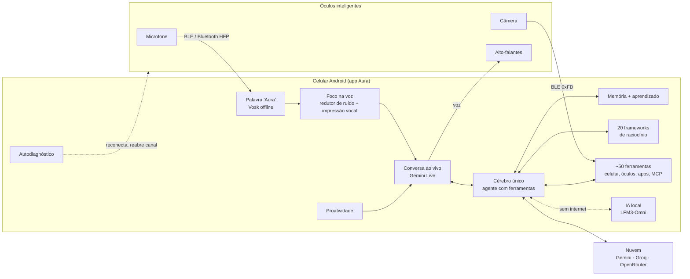

<div align="center">

# Aura Jarvis

### Um assistente pessoal de verdade, que vive nos seus óculos inteligentes e no seu celular

Você fala "Aura". Ela escuta pelo microfone dos óculos, vê pela câmera deles, responde com voz natural no seu ouvido e age no seu celular: agenda, mensagens, e-mail, apps, arquivos, internet. Ela lembra de você, aprende com o uso e conserta sozinha o que trava.

[](LICENSE)


[](CONTRIBUTING.md)

[Visão](docs/VISAO.md) · [Funcionalidades](docs/FUNCIONALIDADES.md) · [Arquitetura](docs/ARQUITETURA.md) · [Protocolo dos óculos](docs/PROTOCOLO-OCULOS.md) · [Roadmap](docs/ROADMAP.md) · [Compilar](docs/COMPILAR.md) · [Contribuir](CONTRIBUTING.md)

</div>

> **English summary.** Aura Jarvis is an open-source, Android-native personal AI assistant for camera smart glasses. It does wake word, full-duplex voice (Gemini Live), vision from the glasses camera, and ~50 native tools over the phone (calendar, SMS, calls, e-mail, WhatsApp, Telegram, files, screen reading, in-app search, MCP servers). It has long-term memory that learns from every conversation, 20 reasoning frameworks, an on-device LLM for offline use, and a self-healing health monitor. The docs are in Portuguese (Brazil) first; English translations are a great first contribution.

---

## Por que a Aura existe

Os assistentes de hoje vivem presos numa tela. Você precisa tirar o celular do bolso, desbloquear, abrir um app e digitar. Os óculos inteligentes com câmera e microfone mudaram isso: o assistente pode estar no seu rosto, ver o que você vê e falar só com você.

Mas o software que vem com esses óculos é limitado. Ele grava foto e vídeo, responde uma pergunta por vez e esquece tudo depois. A Aura é o que esses óculos podem ser: **um Jarvis pessoal e móvel**, que conversa de verdade, enxerga, lembra, age no seu celular e toma a iniciativa quando importa.

E ela é aberta. Qualquer pessoa pode ler o código, rodar no próprio celular, adicionar ferramentas e levar o projeto mais longe.

## O que ela já faz hoje

| | |
|---|---|
| **Conversa por voz de verdade** | Diga "Aura" e converse como numa ligação. Você pode interromper a qualquer momento. A voz é feminina e natural (Gemini Live), e o som vai pelos óculos como um fone Bluetooth, sem bipes. |
| **Enxerga pelos óculos** | "Aura, o que estou vendo?" tira uma foto pelos óculos, lê textos e descreve a cena. O "modo olhar" manda imagens a cada poucos segundos durante a conversa. |
| **Age no celular** | Agenda, lembretes, alarmes, timers, contatos, ligações, SMS, WhatsApp, Telegram, e-mail (IMAP/SMTP), arquivos, leitura de tela, abrir apps, buscar e tocar vídeos no YouTube, músicas no Spotify, rotas no Maps. |
| **Lembra e aprende** | Memória de longo prazo no próprio celular. Depois de cada conversa ela guarda sozinha fatos sobre você, como você prefere que ela aja e lições do que deu errado. |
| **Pensa com método** | 20 frameworks de raciocínio (5 porquês, Eisenhower, pre-mortem, matriz de decisão, seis chapéus e outros) aplicados por baixo dos panos quando você traz um problema ou uma decisão. |
| **Toma a iniciativa** | Resumo da manhã, lembrete antes de cada compromisso com o local e a rota, prévia do dia seguinte à noite, mensagens importantes lidas em voz alta, bateria baixa dos óculos e do celular. Tudo respeita o horário de silêncio. |
| **Conserta a si mesma** | A cada 30 segundos ela confere óculos, Bluetooth, fotos, internet e ferramentas. Quando algo trava, ela reconecta ou reabre o canal sozinha e registra o diagnóstico. |
| **Funciona offline** | Palavra "Aura" reconhecida sem internet (Vosk), um modelo de linguagem rodando no próprio celular (LFM3-Omni via llama.cpp), tradução e leitura de texto no aparelho (ML Kit). |
| **Se conecta a tudo** | Cliente MCP com OAuth: GitHub, Notion, Linear, Zapier (Google), Hugging Face e qualquer servidor MCP por HTTP viram ferramentas da Aura. Skills em Markdown ensinam rotinas novas sem programar. |
| **Segura por padrão** | Chaves guardadas criptografadas no aparelho. Ela confirma antes de enviar mensagem, e-mail, SMS ou ligar. Texto de e-mails, notificações e páginas é tratado como informação, nunca como ordem. |

A lista completa, ferramenta por ferramenta, está em [docs/FUNCIONALIDADES.md](docs/FUNCIONALIDADES.md).

## Como ela funciona



Os detalhes de cada bloco estão em [docs/ARQUITETURA.md](docs/ARQUITETURA.md).

## Em números

- **~18.400 linhas** de Kotlin, em 80 arquivos e 17 módulos
- **103 testes** de unidade passando
- **49 ferramentas nativas** que a IA pode chamar, mais as de cada conexão MCP
- **20 frameworks** de raciocínio e **11 skills** prontas
- **6 provedores de IA** suportados (Gemini, Gemini Live, Groq, OpenRouter, Ollama Cloud, IA local)
- **1 protocolo de óculos** documentado do zero, para interoperabilidade

## Hardware

Desenvolvido e testado com:

- Óculos com câmera da família QC / oudmon (testado no modelo AIMB-G2 Pro, os mesmos óculos usados pelo app DZZ). O app também reconhece S3 Ultra, AUXOM e nomes parecidos.
- Celular Android 8 ou mais novo. O alvo de referência é um Galaxy Note 10+ dedicado (12 GB de RAM), que dá conta até da IA local.

Sem os óculos, a Aura funciona inteira no celular, usando o microfone e a câmera dele.

## Comece em 5 minutos

1. Instale o Android Studio (ou só o JDK 17 e o Android SDK 35).
2. Clone o repositório e baixe o modelo de voz offline:
   ```bash
   git clone https://github.com/m4rkdevbr/aura-jarvis.git
   cd aura-jarvis
   ./tools/baixar-modelos.sh        # no Windows: .\tools\baixar-modelos.ps1
   ```
3. Compile e instale:
   ```bash
   gradlew.bat assembleDebug        # Windows
   adb install -r app/build/outputs/apk/debug/app-debug.apk
   ```
4. Abra a Aura, vá em **Ajustes > Cérebro e nuvem** e cole a sua chave do Gemini (grátis em [aistudio.google.com](https://aistudio.google.com/apikey)). As outras chaves são opcionais.
5. Na aba **Óculos**, conecte os óculos. Feche o app oficial antes, porque os dois não podem usar o Bluetooth ao mesmo tempo.
6. Diga **"Aura"**.

O passo a passo completo, com permissões e solução de problemas, está em [docs/COMPILAR.md](docs/COMPILAR.md).

## Para onde vamos

A Aura já é útil no dia a dia. O plano é transformá-la na referência aberta de assistente pessoal vestível:

- **Multimodal contínuo**: entender a cena em tempo real, reconhecer pessoas que você autorizou e lembrar onde você deixou as coisas
- **Agente de longo prazo**: tarefas que duram dias, como acompanhar um pedido, negociar um horário ou preparar uma viagem inteira
- **Memória semântica** com busca por significado, linha do tempo da sua vida e "o que eu fiz ontem às 15h?"
- **Mais óculos**: Ray-Ban Meta, Brilliant Frame, Even Realities, Mentra e outros por adaptadores de protocolo
- **Plugins da comunidade**: um catálogo aberto de skills e conexões MCP
- **Versão em inglês e espanhol**, e voz em vários idiomas

O roadmap completo, com o que já está pronto e o que precisa de ajuda, está em [docs/ROADMAP.md](docs/ROADMAP.md).

## Contribua

Este é o começo de algo grande, e ele precisa de gente. Você pode ajudar com Kotlin e Android, áudio e Bluetooth, IA e prompts, design de interface, documentação, tradução ou simplesmente testando com os seus óculos e contando o que aconteceu.

Comece por [CONTRIBUTING.md](CONTRIBUTING.md). As issues marcadas como `boa primeira issue` são pensadas para quem está chegando.

## Segurança e privacidade

A Aura tem acesso a coisas muito pessoais: mensagens, e-mails, agenda, câmera. Por isso ela foi desenhada para que os seus dados fiquem no seu celular, que as chaves fiquem criptografadas e que nenhuma ação para fora (enviar, ligar, pagar) aconteça sem a sua confirmação. Leia [docs/SEGURANCA-E-PRIVACIDADE.md](docs/SEGURANCA-E-PRIVACIDADE.md). Para relatar uma falha, siga [SECURITY.md](SECURITY.md).

## Aviso

A Aura é um projeto independente e de código aberto. Ela não é afiliada, endossada nem patrocinada pelos fabricantes dos óculos nem pelos autores do app DZZ. O protocolo dos óculos foi documentado para fins de interoperabilidade, e nenhum código de terceiros está incluído neste repositório. Os nomes de produtos citados pertencem aos seus donos.

## Licença

[MIT](LICENSE). Use, modifique e distribua à vontade, mantendo o aviso de autoria.
