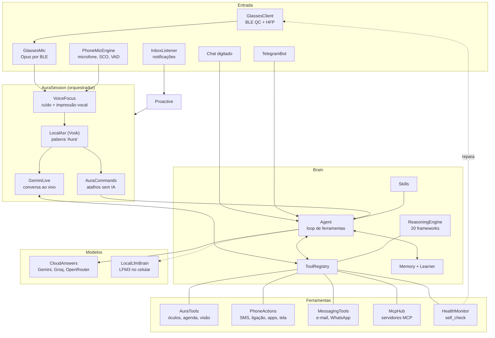

# Arquitetura

A Aura é um app Android nativo, escrito em Kotlin, com interface em Jetpack Compose. Ela não depende de servidor próprio: o celular é o computador, os óculos são os sentidos e a nuvem é opcional.

## Visão geral



## Os módulos

| Pacote | Papel |
|---|---|
| `glasses/` | Conexão com os óculos: varredura, GATT, fila de escrita, canal de comando QC, miniaturas, importação de mídia, serviço em primeiro plano |
| `protocol/` | Formato dos pacotes dos óculos (cabeçalho `BC`, CRC-16/MODBUS), montagem de quadros, pedaços de miniatura, manifesto de mídia, Wi-Fi |
| `voice/` | Tudo de áudio: microfones, Vosk, segmentação, redutor de ruído, impressão vocal, Gemini Live, comandos rápidos e o orquestrador `AuraSession` |
| `brain/` | Agente, registro de ferramentas, prompt de sistema, memória, aprendizado, frameworks de raciocínio e skills |
| `copilot/` | Ponte com os modelos: respostas na nuvem, voz (TTS), player da conversa, visão (ML Kit), IA local, imagens |
| `phone/` | Ações no celular, regras de confirmação, leitura de notificações, acessibilidade, busca dentro de apps |
| `email/` | IMAP/SMTP e ferramentas de mensagens |
| `telegram/` | Bot do Telegram ligado ao mesmo cérebro |
| `mcp/` | Cliente MCP (Streamable HTTP, OAuth PKCE), catálogo e plugins |
| `proactive/` | Quando a Aura fala por conta própria |
| `health/` | Autodiagnóstico e autocorreção |
| `reminder/` | Alarmes exatos para lembretes com o app fechado |
| `agenda/` | Entender "daqui a dez minutos", "amanhã às 9" |
| `data/` | Preferências (chaves criptografadas), cofre de tarefas e lugares, histórico do chat |
| `ui/` | Telas em Compose e o tema Aurora |
| `widget/` | Widget de status |

O ponto de partida é [`DzzApplication.kt`](../app/src/main/java/app/dzz/copilot/DzzApplication.kt), onde o `AppHub` cria e liga todas as peças.

## O caminho de uma frase

1. **Ouvir.** O microfone em uso (óculos por chamada Bluetooth, óculos por BLE ou celular) entrega quadros de 20 ms a 16 kHz. O `VoiceFocus` limpa o ruído.
2. **Acordar.** O Vosk, offline, procura "Aura". Nada sai do celular antes disso.
3. **Decidir o caminho.**
   - Se for um comando curto e claro ("foto", "bateria"), o `AuraCommands` resolve na hora, sem IA.
   - Se não, abre a conversa ao vivo: o áudio vai direto para o Gemini Live pelo `liveTap`.
4. **Pensar.** O Gemini Live recebe o prompt de sistema do `Brain` (quem você é, preferências aprendidas, fatos, o que está acontecendo agora, skills) e todas as ferramentas como funções.
5. **Agir.** Quando o modelo chama uma ferramenta, o `GeminiLive.runTool` executa com tempo limite (25 s, ou 40 s nas lentas), registra a duração e devolve o resultado.
6. **Falar.** O áudio de 24 kHz toca pelo `LivePlayer` no canal de chamada, que vai para os óculos. Os óculos recebem o aviso 0x48 de "IA falando".
7. **Aprender.** Quando a conversa termina, o `Learner` relê a transcrição e guarda fatos, preferências e lições.

Sem conversa ao vivo (sem chave ou sem rede), o caminho clássico é: Whisper (Groq) transcreve, o `Agent` roda o loop de ferramentas com o primeiro provedor que responder, e o TTS fala.

## Decisões de projeto

- **O celular é o servidor.** Não há backend próprio. Memória, chaves, histórico e modelos ficam no aparelho. A nuvem só recebe o que precisa para responder.
- **Um só cérebro.** Voz, chat, Telegram e proatividade usam o mesmo agente, a mesma memória e as mesmas ferramentas. Uma ferramenta nova aparece em todos os lugares ao mesmo tempo.
- **Ferramentas pequenas e honestas.** Cada ferramenta faz uma coisa e diz exatamente o que aconteceu. O prompt proíbe dizer que fez algo sem a ferramenta confirmar.
- **Confirmação para fora.** Tudo o que sai em seu nome passa por duas chamadas: a primeira monta o pedido, a segunda só roda com `confirmed=true` depois do seu "sim" ([`phone/PhoneRules.kt`](../app/src/main/java/app/dzz/copilot/phone/PhoneRules.kt)).
- **Dados de terceiros não são ordens.** Notificações, e-mails, páginas, arquivos e respostas de MCP chegam marcados como informação.
- **Regras puras e testáveis.** A lógica de decisão (protocolo, regras de proatividade, regras de saúde, aprendizado, busca em apps, entendimento de horários) fica em objetos sem Android, cobertos por testes de JVM.
- **Fallback em tudo.** Modelos em cadeia, microfone com alternativa, conversa ao vivo que cai para o caminho clássico, IA local quando a internet some.

## Testes

```bash
gradlew.bat testDebugUnitTest
```

103 testes cobrem o protocolo dos óculos, pedaços de miniatura, agente e memória, aprendizado, frameworks, skills, comandos de voz, regras de telefone e e-mail, MCP, proatividade, saúde e busca em apps. Há também um avaliador de comandos de voz ([`app/src/test/resources/eval_commands.tsv`](../app/src/test/resources/eval_commands.tsv) e [`tools/eval_device.py`](../tools/eval_device.py)).

## Onde a arquitetura precisa crescer

- `AuraSession.kt` (970 linhas) e `GlassesClient.kt` (1.300 linhas) concentram muita coisa e merecem ser divididos.
- Não há injeção de dependências. O `AppHub` monta tudo à mão, o que é simples mas dificulta testes de integração.
- A memória busca por palavras. Busca semântica com embeddings no aparelho é o próximo passo natural.
- Faltam testes instrumentados (no aparelho) e um simulador dos óculos para testar sem hardware.

Veja o [ROADMAP](ROADMAP.md) para o plano.
