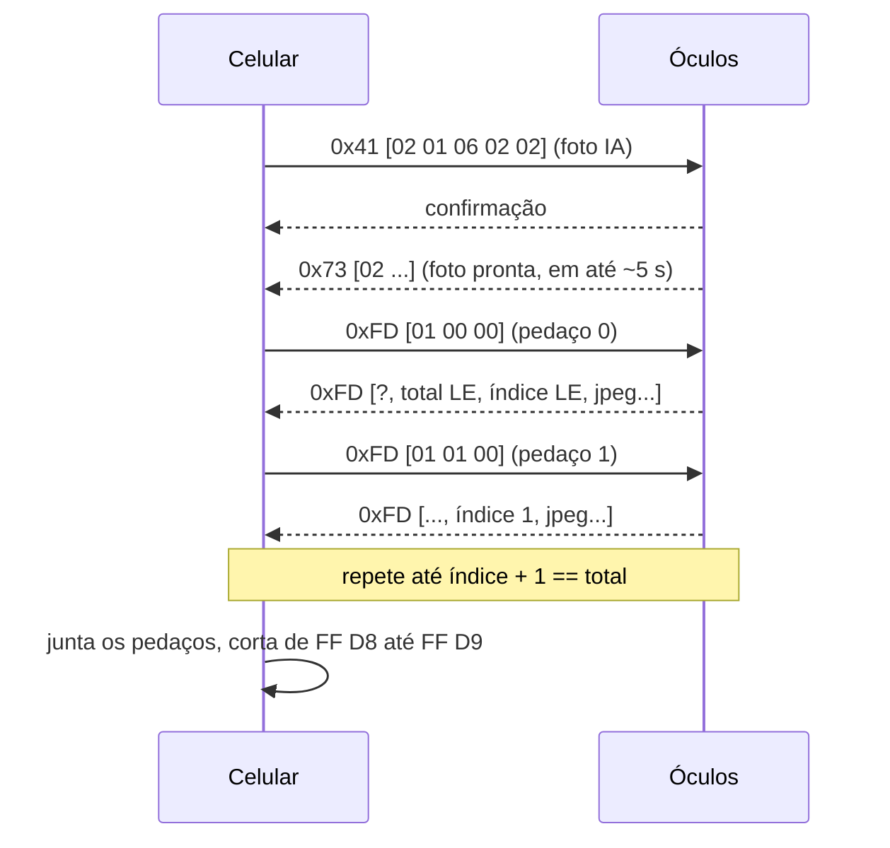

# Protocolo dos óculos (família QC / oudmon)

Este documento descreve, com palavras nossas, como o celular conversa com os óculos de câmera da família QC / oudmon (por exemplo o AIMB-G2 Pro). Ele existe para **interoperabilidade**: para que qualquer pessoa possa escrever software livre para os óculos que comprou. Nenhum código de terceiros está neste repositório.

A implementação de referência é [`protocol/QcProtocol.kt`](../app/src/main/java/app/dzz/copilot/protocol/QcProtocol.kt) e [`glasses/GlassesClient.kt`](../app/src/main/java/app/dzz/copilot/glasses/GlassesClient.kt), com testes em [`QcProtocolTest.kt`](../app/src/test/java/app/dzz/copilot/protocol/QcProtocolTest.kt) e [`ThumbnailChunksTest.kt`](../app/src/test/java/app/dzz/copilot/protocol/ThumbnailChunksTest.kt).

> Viu algo diferente no seu modelo? Abra uma issue com o modelo, o firmware e o registro de **Ajustes > Diagnóstico**. Cada modelo documentado ajuda todo mundo.

## Ligações

Os óculos expõem três caminhos ao mesmo tempo:

| Caminho | Para quê |
|---|---|
| **BLE GATT, serviço QC** | Comandos, bateria, foto IA, miniaturas, microfone em Opus |
| **Bluetooth clássico HFP/A2DP** | Os óculos são um fone: microfone de chamada (com WBS) e alto-falantes |
| **Wi-Fi dos próprios óculos** | Baixar as fotos e vídeos guardados (modo de transferência) |

### UUIDs do serviço QC

| | UUID |
|---|---|
| Serviço | `de5bf728-d711-4e47-af26-65e3012a5dc7` |
| Escrita (celular → óculos) | `de5bf72a-d711-4e47-af26-65e3012a5dc7` |
| Aviso (óculos → celular) | `de5bf729-d711-4e47-af26-65e3012a5dc7` |

Também existe o serviço padrão de bateria (`0x180F`).

## Formato do pacote

```
+------+------+-----------+-----------+-------------------+
| 0xBC | cmd  | len (LE)  | crc (LE)  | payload (len B)   |
| 1 B  | 1 B  | 2 B       | 2 B       |                   |
+------+------+-----------+-----------+-------------------+
```

- `crc` é CRC-16/MODBUS (polinômio `0xA001` refletido, início `0xFFFF`) calculado só sobre o payload.
- Pacotes maiores que o MTU são quebrados em pedaços de `MTU - 3` bytes e escritos em sequência.
- **Escreva um pedaço por vez** com `WRITE_TYPE_DEFAULT` e espere `onCharacteristicWrite` antes do próximo. Se você escrever sem esperar, o Android responde "ocupado" e o pedaço se perde. Foi exatamente esse o bug que fazia fotos falharem.
- Nas respostas de miniatura (`0xFD`) e de evento (`0x73`), os óculos às vezes mandam um CRC que não confere. Aceite esses quadros quando o próximo byte for `0xBC` ou o buffer acabar.

## Comandos

| cmd | Nome | Payload enviado | Observações |
|---|---|---|---|
| `0x40` | Acertar hora | segundos Unix, 4 bytes LE | |
| `0x41` | Controle | `02 01 xx` (veja abaixo) | |
| `0x42` | Bateria | vazio | Resposta: `[nível 0..100, carregando]` |
| `0x43` | Informações do aparelho | vazio | Firmware e modelo |
| `0x45` | Batimento | | Mantém o canal vivo |
| `0x48` | IA falando | `02 01` início, `02 02` continua (a cada 2 s), `02 03` fim | Avisa os óculos de que o áudio é uma resposta da IA |
| `0x59` | Upload de áudio | (óculos → celular) | Opus 16 kHz mono cru, pacotes fixos de 40 bytes (20 ms), sem cabeçalho |
| `0x73` | Evento | (óculos → celular) | `payload[0] == 2`: a foto IA está pronta |
| `0x08` | IP | (óculos → celular) | IP dos óculos no Wi-Fi |
| `0xFD` | Miniatura | `01 idx_lo idx_hi` | Pede o pedaço `idx` da foto IA |

### Subcomandos de controle (`0x41`, payload `02 01 xx`)

| xx | Ação |
|---|---|
| `01` | Foto (guardada nos óculos) |
| `02` / `03` | Começar / parar vídeo |
| `04` | Modo de transferência por Wi-Fi |
| `06 q q` | **Foto IA** (5 bytes no total: `02 01 06 02 02`, qualidade 2 de 0..5) |
| `07` | Abrir o microfone de IA (upload `0x59`) |
| `08` / `0C` | Começar / parar gravação de áudio |
| `09` | Parar transferência |
| `0B` | Fechar o microfone de IA |
| `0D` | Tocar para encontrar os óculos |
| `12` / `13` | Começar / parar tradução |

## Foto IA, passo a passo

Este é o fluxo que faz o "o que estou vendo" funcionar:



Regras práticas que aprendemos no hardware:

- Se o aviso `0x73` não vier em 5 segundos, peça o pedaço 0 mesmo assim.
- Uma foto típica tem cerca de 17 pedaços.
- Se um pedaço não chegar em ~1,3 s, peça de novo o **primeiro pedaço que falta**, em vez de recomeçar a foto.
- Ignore pedaços repetidos. Um `total` diferente significa uma foto nova.
- Durante a transferência, segure os avisos `0x48`, para não competir pelo canal.

## Microfone

Há dois jeitos de ouvir pelos óculos:

1. **Chamada Bluetooth (recomendado).** Os óculos aceitam HFP com voz de banda larga. No Android: `setCommunicationDevice` (SCO/BLE headset), `MODE_IN_COMMUNICATION` e gravação com `VOICE_COMMUNICATION`, que traz o cancelamento de eco. Sem bipes e com a menor latência.
2. **Upload de IA por BLE.** O `0x41 [02 01 07]` abre o microfone e os óculos mandam Opus em `0x59`. Mas os óculos **fecham o upload sozinhos depois de ~4,8 s** (cerca de 239 pacotes) e **apitam a cada abertura**. Serve para um pedido curto, não para uma conversa.

## Wi-Fi e mídia

- O `0x41 [02 01 04]` coloca os óculos em modo de transferência. A resposta traz SSID e senha (`02 01 04 ?, ssid_len LE, pass_len LE, ssid, senha`), e o IP chega em `0x08` ou em `0x41 [02 03 ip]`.
- Com o celular na rede dos óculos, a lista de arquivos está em `http://IP/files/media.config` e cada arquivo é baixado por HTTP ([`protocol/MediaManifest.kt`](../app/src/main/java/app/dzz/copilot/protocol/MediaManifest.kt), [`glasses/MediaSync.kt`](../app/src/main/java/app/dzz/copilot/glasses/MediaSync.kt)).

## Firmware

O firmware é fechado e é atualizado só pelo app do fabricante. A Aura não altera o firmware.

## Outros óculos

Óculos com chips Beken, Lanxun ou JieLi podem conectar e mostrar a bateria pelo serviço padrão. Foto, microfone e Wi-Fi só funcionam se o mesmo serviço QC aparecer. O registro de diagnóstico lista os serviços encontrados.

Queremos adaptadores para outros óculos (Ray-Ban Meta, Brilliant Frame, Even Realities, Mentra e outros). Veja o [ROADMAP](ROADMAP.md).
